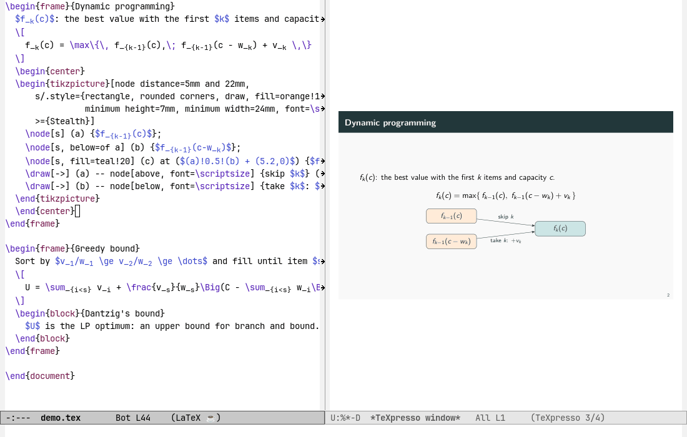

# texpresso-view

**A live LaTeX preview inside Emacs.** Type in the source and the page beside it updates in a fraction of a
second, with no saving, no compiling and no PDF.

[](LICENSE)
[](https://www.gnu.org/software/emacs/)



[TeXpresso](https://github.com/let-def/texpresso), by Frédéric Bour, re-typesets a LaTeX document as you edit
it, starting again only from the page you touched. Normally it shows the pages in a window of its own.
texpresso-view puts them inside Emacs instead, in the window next to your source, the way
[pdf-tools](https://github.com/vedang/pdf-tools) shows a PDF. Source and page stay in step both ways.

It was written for Beamer decks, where a full compile takes seconds and you want to see every slide as you
write it, but it works for any LaTeX document that XeLaTeX can typeset.

## Features

- **Live typesetting.** An edit reaches the page in a fraction of a second: 0.06–0.23 s anywhere in a
  120-page deck.
- **Sync in both directions.** The page follows the cursor and the scrolling. Turn the page (`n`/`p`) and the
  source jumps to where that page starts: a Beamer frame's `\begin{frame}`, in whichever `\input` file it
  lives.
- **Click to jump.** Click on the page to go to the source line under the click.
- **Copy from the page.** Drag across the page to highlight the text and copy it to the kill ring.
- **Errors where you see them.** When the text stops TeX (an unclosed brace, a missing `\end{document}`), a red
  line over the page says what went wrong and where, until you fix it. Other errors are counted in the mode
  line.
- **Your theme's colours.** The page is drawn in the colours of your Emacs theme and follows a theme switch.
- **Whole documents too.** `C-u M-x texpresso-view` typesets AUCTeX's `TeX-master`, for example a course that
  `\input`s its decks, while you edit one file of it.
- **Slides with the mouse.** Put pictures and text boxes on a Beamer slide, then drag and resize them as in
  Google Slides; the LaTeX source follows as you drag. A strip of slides on the left reorders, copies,
  deletes and adds frames.
- **Edits made on disk too.** When a script or an AI agent writes your files, the page follows: a file open in
  Emacs once Emacs reverts it (`auto-revert-mode` or `global-auto-revert-mode`), an `\input` file not open as
  soon as it is written, if it is in the document's folder or below it.
- **Texinfo manuals too.** A `.texi` file, GNU's documentation format, is typeset with plain TeX's format,
  which `texinfo.tex` is written for, and its `@include` files follow edits as `\input` files do.
- **Terminal Emacs.** In `emacs -nw` the page is drawn as a Sixel picture, in terminals that support it
  (foot, WezTerm, Konsole, xterm).

## Requirements

- Emacs 29.1 or later, graphical, or in a Sixel-capable terminal.
- **TeXpresso built with the patches in [`texpresso/`](texpresso/)**. Stock TeXpresso can only draw in its own
  window. The patches add the commands that let an editor show the page, plus a set of stability fixes (see
  [The TeXpresso patches](#the-texpresso-patches)). The aim is to get them upstream.
- A TeX distribution with XeTeX (TeX Live, or Tectonic).
- TeXpresso's own Emacs mode, `texpresso.el`, which ships in TeXpresso's `emacs/` folder.
- AUCTeX, only for typesetting a whole document (`C-u`, below).

Tested with Emacs 31.1 (pgtk on Wayland, and `emacs -nw` in foot 1.28) and TeX Live 2026.

## Installation

**1. Build TeXpresso with the patches.** They are applied on the `texpresso-view` branch of
[stefanoconiglio/texpresso](https://github.com/stefanoconiglio/texpresso/tree/texpresso-view), a fork of
TeXpresso:

```sh
git clone -b texpresso-view https://github.com/stefanoconiglio/texpresso
make -C texpresso all
```

Or apply the patch files of this repository to TeXpresso's own `main`:

```sh
git clone https://github.com/let-def/texpresso
git -C texpresso am /path/to/emacs-texpresso-view/texpresso/*.patch
make -C texpresso all
```

Either way, this builds `texpresso/build/texpresso` and `texpresso/build/texpresso-xetex`. TeXpresso's
[INSTALL.md](https://github.com/let-def/texpresso/blob/main/INSTALL.md) lists what the build needs (MuPDF,
SDL2, a TeX distribution).

**2. Load the package.** With `use-package`:

```elisp
(use-package texpresso
  :load-path "/path/to/texpresso/emacs"
  :custom
  (texpresso-binary "/path/to/texpresso/build/texpresso")
  (texpresso-follow-cursor t))          ; the page follows the cursor

(use-package texpresso-view
  :load-path "/path/to/emacs-texpresso-view"
  :after texpresso
  :commands texpresso-view)
```

## Usage

Open a `.tex` (or `.texi`) file and run **`M-x texpresso-view`**. The page opens to the right. Run the command again in
the same buffer to close it and stop TeXpresso.

With a prefix, **`C-u M-x texpresso-view`** typesets AUCTeX's `TeX-master`, the whole document the file
belongs to.

In the page's window:

| Key                                       | Action                                    |
|-------------------------------------------|-------------------------------------------|
| `n`, `SPC`, `PageDown`, `↓`, `→`, wheel down | next page                              |
| `p`, `DEL`, `PageUp`, `↑`, `←`, wheel up     | previous page                          |
| click                                     | jump to the source line under the click   |
| drag                                      | highlight the text crossed and copy it    |
| `q`                                       | close the window                          |

A click also selects the page's window, so its keys work at once.

## Slides with the mouse

A Beamer deck can be edited as in Google Slides, and the LaTeX source follows.

**On the page.** Put a picture or a text box on the slide, then drag it where you want it, or pull a corner to
resize it. While you drag, the source changes and TeXpresso redraws the slide. A whole drag is one undo.

| Key in the page's window     | Action                                                                   |
|------------------------------|--------------------------------------------------------------------------|
| `i`                          | put a picture (PNG, JPEG, PDF) on the slide, where you last clicked      |
| `C-y`                        | paste the picture on the clipboard (a screenshot), saved in `figures/`   |
| drop a file                  | a picture dragged from a file manager goes where it's dropped            |
| `t`                          | a text box; the cursor goes to its text in the source, to type over      |
| click on an object           | select it: a blue outline with four handles                              |
| drag an object / a corner    | move it / resize it, its aspect kept                                     |
| arrows                       | move the object selected by half a unit (`C-u` for 2 units); without one, turn pages |
| `+` / `-`                    | make it a tenth larger / smaller                                         |
| `d`, `DEL`, `RET`            | copy it, delete it (onto the kill ring), show it in the source           |
| `]`, `[`                     | bring it forward, send it back                                           |
| `Esc`                        | unselect                                                                 |
| `s`                          | open or close the slide strip                                            |

What goes on a slide is plain TikZ. Each object is a node in the frame's `tvlayer`, at `(x,y)` from the
slide's top left corner, in hundredths of the slide's width (`\tvu`), whatever its aspect ratio:

```latex
\begin{frame}{Results}
  Text in the flow, as usual.
  \begin{tvlayer}
    \node[tv] at (10,20) {\includegraphics[width=30\tvu]{figures/plot.png}};
    \node[tv,text width=40\tvu,align=left] at (55,20) {A text box};
  \end{tvlayer}
\end{frame}
```

The first object placed adds the definitions before `\begin{document}`: a short block between
`% texpresso-view slides: begin` and `end` comments, needing only TikZ. So the deck still builds with
`pdflatex`, `xelatex` or `lualatex`, with or without this package. You can write and edit such nodes by
hand too: the mouse finds them all the same, because TeX writes each object's place and size to its log.

**The slide strip** (`s` in the page's window, or `M-x texpresso-view-slides`) opens on the left. It shows
every frame of the deck, also those in `\input` files, each with a small picture of its page and its title.
The slide on display is highlighted.

| Key in the strip      | Action                                                                  |
|-----------------------|-------------------------------------------------------------------------|
| click, `RET`          | show that slide; the source window goes to its frame                    |
| `n` / `p`, `↓` / `↑`  | next / previous slide                                                   |
| `M-↑` / `M-↓`, drag   | move the slide up / down, or to where it's dropped                      |
| `d`                   | copy the slide after itself                                             |
| `DEL`                 | delete the slide (onto the kill ring: `C-y` in the source brings it back) |
| `+`, `a`              | add a slide after this one, from a layout (`texpresso-view-layouts`)    |
| `g`, `q`              | redraw, close                                                           |

A slide moves with the comment and setting lines right above its `\begin{frame}`, such as a
`\setlength` for that frame. Slides made by a macro (`\AtBeginSection`, a command holding a frame) are not
in the strip, and nothing can be placed on them: there is no `\begin{frame}` of theirs in the deck to edit. While the strip is open, TeXpresso typesets to the end of the deck so that
every slide has its picture.

Everything is edited in the source buffers, unsaved, so save them as usual.

## Configuration

| Variable                  | Package         | Default | What it does                                          |
|---------------------------|-----------------|---------|-------------------------------------------------------|
| `texpresso-binary`        | `texpresso.el`  | `nil`   | path to the patched `texpresso`                       |
| `texpresso-follow-cursor` | `texpresso.el`  | `nil`   | `t`: the page follows the cursor                      |
| `texpresso-view-cell-size`| texpresso-view  | `nil`   | terminal cell size `(W . H)` in pixels, if the terminal doesn't report it |
| `texpresso-view-layouts`  | texpresso-view  | six     | the layouts of a new slide in the strip: `(NAME . FRAME-SOURCE)` |

## Terminal Emacs

In `emacs -nw` or `emacsclient -t`, Emacs asks the terminal whether it can draw Sixel pictures, how large its
character cells are and which colours it uses. The page then becomes a Sixel picture drawn over its window,
redrawn when the page, the window or the frame changes. Clicks and drags need `xterm-mouse-mode`.

- Inside tmux or zellij, the page shows only if the multiplexer passes Sixel through.
- With no Emacs theme, the page uses the terminal's own colours, and follows a recolouring from outside Emacs
  (a desktop theme switch) once the terminal has the focus again. For Emacs's own text to follow too, keep
  the default face on the terminal's colours:

  ```elisp
  (add-hook 'tty-setup-hook
            (lambda ()
              (set-face-attribute 'default (selected-frame)
                                  :background "unspecified-bg" :foreground "unspecified-fg")))
  ```

Tested in foot 1.28.

## How it works

TeXpresso is fast because it never makes a PDF. It runs a modified XeTeX that keeps snapshots of itself as it
typesets, so an edit re-typesets only from the page it changes. It then draws XeTeX's page descriptions (XDV)
directly with MuPDF.

Here TeXpresso runs with no window. Emacs asks it to write the page on display as a PNG the size of the Emacs
window (`render-to`), and shows that PNG as an image. A click is sent back as pixel coordinates
(`click-at`), which TeXpresso maps to a source line through SyncTeX; a drag asks for the text between two
points (`select`). Each new image comes with the source line its page starts at, which is how turning a page
moves the source. Scrolling the source sends a SyncTeX search the other way. The PNG lives in
`temporary-file-directory` and is deleted when the view closes or Emacs quits.

TeXpresso reads a file from disk once. A file open in Emacs reaches it from the buffer, as you type; a file
written by another program reaches it when Emacs reverts the buffer, which sends the whole buffer again. For
the files that are not open, the view watches the document's folder and its subfolders (at most 100), and when
a file there changes it asks TeXpresso to read the changed files again (`rescan`).

## The TeXpresso patches

The patches in [`texpresso/`](texpresso/) apply to TeXpresso's `main`; the same commits are the
[`texpresso-view` branch](https://github.com/stefanoconiglio/texpresso/tree/texpresso-view) of the fork. Some are
what this package needs; the others fix bugs found while using it every day.

| Patch | What it does |
|-------|--------------|
| 0004 | **Editor commands**: `render-to` (the page as a PNG), `click-at` (SyncTeX from a click), `select` (text between two points) |
| 0005 | The page's source line, sent with each image |
| 0008, 0011 | The page as a Sixel picture, for terminal Emacs |
| 0010 | A theme change recolours the page at once |
| 0003 | Text can be copied from XeTeX output (characters recovered from each font's character map) |
| 0001, 0002 | Reruns: an edit during a rerun no longer stops TeX for good or crashes TeXpresso (upstream: [let-def/texpresso#163](https://github.com/let-def/texpresso/pull/163)) |
| 0012 | Memory: TeXpresso no longer keeps a copy of every file each time TeX starts over (upstream: [let-def/texpresso#165](https://github.com/let-def/texpresso/pull/165)) |
| 0006 | Edits to an `\input` file always show (it was read from disk once the buffer's length differed) |
| 0007 | A document that stops TeX is no longer reported as a crash |
| 0009 | Snapshots spread over the whole document: in a 120-page deck, an edit anywhere shows in 0.06–0.23 s instead of up to 2.6 s |
| 0013, 0014, 0015 | Cleanup: snapshots end with TeXpresso, finished TeX runs are reaped, a cache loop fixed |
| 0016 | Texinfo files are typeset with plain XeTeX's format instead of LaTeX's |
| 0017 | A `thumbnails` command: every page as a small PNG for the slide strip, TeX typesetting to the end meanwhile |

## Notes and limitations

- texpresso-view is a preview: build the final PDF with your usual engine (pdfLaTeX, LuaLaTeX, latexmk).
- TeXpresso typesets with XeTeX only: code for LuaTeX alone (`\directlua`, `luacode`) does not run. A
  document set in T1-encoded fonts (`fontenc`, `lmodern`) loses the typographic quotes typed as such, unless
  its preamble loads `fontspec` under XeTeX.
- TeXpresso runs no other program: `\write18` (shell escape) is off, so minted and TikZ externalization cannot
  make new files; BibTeX or Biber must be run by hand for a key cited for the first time;
  a Texinfo manual's index stays empty, since `texindex` is not run. Copying text from a Texinfo
  page loses the ff and fi ligatures of its Computer Modern fonts.
- Reruns are on: after a pause, if the `.aux` file changed, TeXpresso typesets once more, as a second
  pdflatex run would (references, the table of contents, Beamer's total slide count).
- A whole document (`C-u`) is slower to start and uses more memory: on a 644-page course, 28 s to reach page
  422 and about 850 MB. Later edits take 0.1–0.25 s.
- With `pixel-scroll-precision-mode` on, the mouse wheel over the page scrolls instead of turning pages.
- If [pdf-view-scroll-sync](https://github.com/stefanoconiglio/emacs-pdf-view-scroll-sync) is on in the buffer,
  it is turned off when the view opens, so that saving does not also compile with latexmk.

## Related projects

- [TeXpresso](https://github.com/let-def/texpresso): the engine, with modes for Emacs, Neovim and Zed.
- [texpresso-vscode](https://github.com/DominikPeters/texpresso-vscode): TeXpresso in VS Code, by Dominik
  Peters, with an in-editor preview in the works.
- [pdf-tools](https://github.com/vedang/pdf-tools): the PDF viewer whose way of working this package follows.

## License

GPL-3.0-or-later, see [LICENSE](LICENSE). The patches in `texpresso/` are for TeXpresso and under its licence
(MIT).
